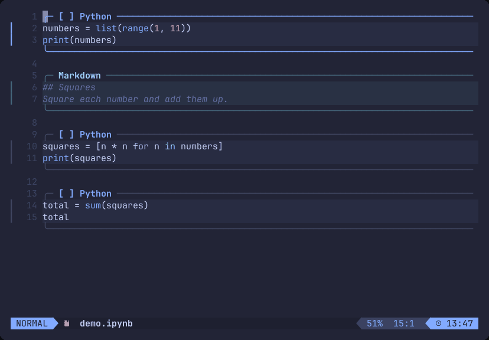
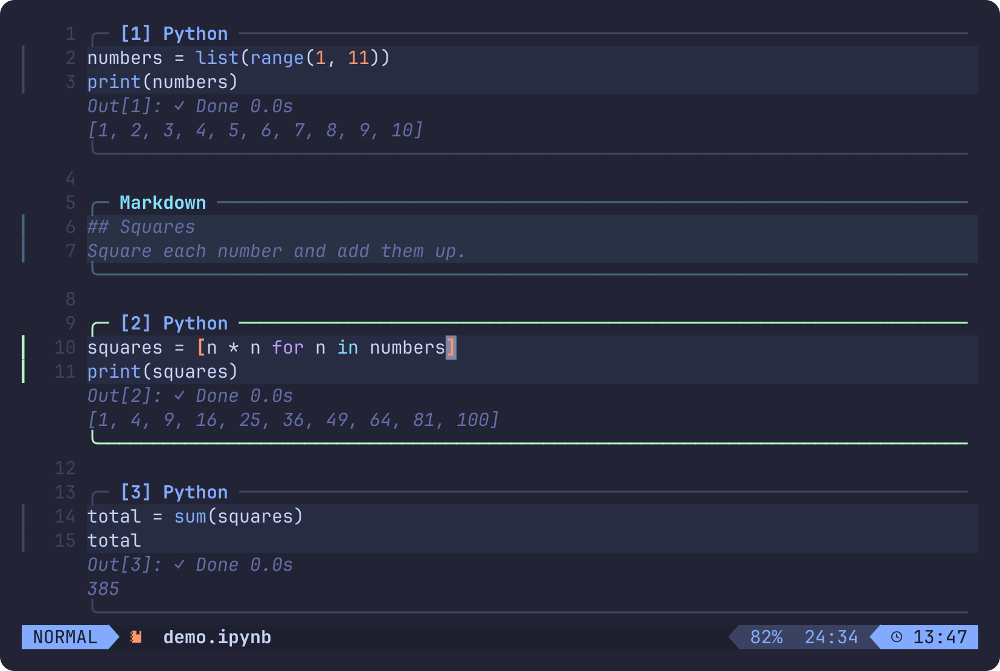

# notebook-cells.nvim

A Neovim plugin for editing `.ipynb` files. It draws each cell as a box, lets you move between cells with `j` and `k` like in Jupyter, and starts the kernel from the notebook's own virtualenv.



When a cell is selected (command mode), `j` and `k` move between cells. The selected cell has a blue border:


Press `Enter` or `i` to edit the cell. The border turns green, and now `j` and `k` move between lines like they normally do. `Esc` in normal mode takes you back to command mode:



It builds on two other plugins and does not replace them:

| Plugin | What it does |
|---|---|
| [jupytext.nvim](https://github.com/GCBallesteros/jupytext.nvim) | Opens an `.ipynb` as a script with `# %%` cell markers and converts it back when you save |
| [molten-nvim](https://github.com/benlubas/molten-nvim) | Runs code on a Jupyter kernel and shows the output |
| notebook-cells.nvim | Draws the cells, adds the command/edit modes and keys, picks the kernel, and keeps `git diff` small |

## What it does

- Draws each cell with a header (`╭─ [3] Python ───`), a bar on the left, a footer and a slightly different background. The number in the header is the cell's execution count, like Jupyter: `[ ]` for a cell that was never run, `[*]` while it runs or waits, `[3 ✗]` when it failed. Markdown cells get another tint and the leading `# ` is hidden. The colors come from your colorscheme.
- Hides the `# ---` YAML block that jupytext puts at the top of the file, and numbers the lines from 1. This needs Neovim 0.11. The block is still saved.
- Has two modes, like Jupyter. In command mode a cell is selected and the keys act on cells. In edit mode you are inside the cell and Neovim works as usual.
- Runs cells on a Jupyter kernel through molten-nvim: run the cell, run and advance, run and insert a new cell, run all, run above, run below. Run all, run above and run below stop at the first cell that fails and say which one.
- Controls the kernel: interrupt, restart, restart and run all, restart and clear outputs, select a different kernel.
- Clears the output of one cell or of all cells. Clearing all outputs is also written to the file the next time you save, so you can clear before a commit.
- Edits the structure: add, delete, cut, copy and paste cells, move a cell up or down, merge with the cell below, split at the cursor, change a cell between code and markdown. Moving a cell keeps its output.
- Finds the nearest `.venv` above the notebook, registers it as a Jupyter kernel and starts it. If there is no venv, it opens molten's kernel picker.
- Restores unchanged cells after saving. jupytext rewrites the whole file on save (trailing newlines, metadata and so on), which makes noisy diffs. After each save this plugin puts every cell you didn't touch back exactly as it was, so `git diff` only shows the cells you changed.
- Can keep outputs in the `.ipynb`: write them on save and show them again when the kernel starts. Both are off by default.

## Keys

All keys are buffer-local and only exist in notebook buffers. `<leader>` is whatever you use as leader (space in LazyVim).

Command mode (a cell is selected). In edit mode these keys keep their normal Vim meaning.

| Key | Action |
|---|---|
| `j` / `k` | next / previous cell |
| `Enter` or `i` | edit the cell |
| `a` / `b` | add a cell above / below |
| `dd` | delete the cell (it is kept for pasting) |
| `x` / `c` | cut / copy the cell |
| `v` / `V` | paste below / above |
| `M` | merge with the cell below |
| `m` / `y` | change the cell to markdown / code |
| `u` | undo (this is Neovim's normal undo) |

In both modes:

| Key | Action |
|---|---|
| `Esc` (edit mode) | back to command mode |
| `]c` / `[c` | next / previous cell |
| `<leader>mc`, `Ctrl+Enter` | run cell |
| `<leader>mn`, `Shift+Enter` | run cell and go to the next one (adds a cell after the last) |
| `<leader>mO`, `Alt+Enter` | run cell and insert a new one below |
| `<leader>mR` | run all cells |
| `<leader>mU` | run all cells above |
| `<leader>mB` | run this cell and all below |
| `<leader>mx` | interrupt the kernel |
| `<leader>mK` | restart the kernel |
| `<leader>mZ` | restart the kernel and run all cells |
| `<leader>mC` | clear this cell's output |
| `<leader>mX` | clear all outputs |
| `<leader>m[` / `<leader>m]` | move the cell up / down |
| `<leader>ms` | split the cell at the cursor |
| `<leader>ma` / `<leader>mA` | new code / markdown cell below, ready to type in |
| `<leader>mi` | start the project's kernel |
| `<leader>mI` | select a different kernel |

`Ctrl+Enter`, `Shift+Enter` and `Alt+Enter` only work if your terminal sends them as separate keys. If one does nothing, use the `<leader>` version. Every key can be changed or turned off, see Configuration.

Every action is also a command: `:NotebookCellsRun`, `:NotebookCellsRunNext`, `:NotebookCellsRunAll`, `:NotebookCellsRunAbove`, `:NotebookCellsRunBelow`, `:NotebookCellsInterrupt`, `:NotebookCellsRestart[!]`, `:NotebookCellsRestartRunAll[!]`, `:NotebookCellsClearOutput`, `:NotebookCellsClearAllOutputs`, `:NotebookCellsKernel`, `:NotebookCellsSelectKernel`, `:NotebookCellsSaveOutputs`, `:NotebookCellsLoadOutputs`. The `!` on the restart commands also clears the outputs.

## Requirements

- Neovim 0.10 or newer
- [jupytext.nvim](https://github.com/GCBallesteros/jupytext.nvim) and the `jupytext` command (`uv tool install jupytext` or `pipx install jupytext`)
- [molten-nvim](https://github.com/benlubas/molten-nvim), which needs `pynvim` and `jupyter_client` in Neovim's Python host
- `python3` on your `PATH` for the save helper (it only uses the standard library)
- Optionally [uv](https://github.com/astral-sh/uv), used to install `ipykernel` into project venvs. Without it the plugin uses `pip`.

Run `:checkhealth notebook_cells` to check your setup.

## Install

With lazy.nvim:

```lua
{
  "mfshobur/notebook-cells.nvim",
  lazy = false, -- it has to be loaded before the first .ipynb is opened
  dependencies = {
    {
      "GCBallesteros/jupytext.nvim",
      lazy = false,
      opts = { style = "percent", output_extension = "auto", force_ft = "python" },
    },
    {
      "benlubas/molten-nvim",
      version = "^1.0.0",
      build = ":UpdateRemotePlugins",
      init = function()
        -- Show output inline under the cell only. With auto_open_output molten also
        -- opens a floating window over the cell.
        vim.g.molten_auto_open_output = false
        vim.g.molten_virt_text_output = true
        -- For inline plots install ImageMagick, add 3rd/image.nvim (backend = "kitty",
        -- processor = "magick_cli") and use a terminal with the kitty graphics protocol:
        -- vim.g.molten_image_provider = "image.nvim"
      end,
    },
  },
  opts = {},
}
```

jupytext.nvim must use `style = "percent"`. That is the only format this plugin reads.

## Configuration

These are the defaults. The same table is in [`lua/notebook_cells/config.lua`](lua/notebook_cells/config.lua).

```lua
require("notebook_cells").setup({
  patterns = { "*.ipynb" },
  labels = { code = "Python", markdown = "Markdown" },
  border = { top = "╭─", rule = "─", bottom = "╰", bar = "▎" },
  hide_header = true,    -- hide jupytext's YAML block (Neovim 0.11+)
  modal = true,          -- false: no command mode, behave like a normal buffer
  highlights = {},       -- for example { Active = { fg = "#ff9e64" } }

  -- Each key can be a string, a list of strings, or false to turn it off.
  -- keymaps = false turns all of them off.
  keymaps = {
    -- command mode
    next_cell = "j", prev_cell = "k",
    edit = { "<CR>", "i" },
    add_above = "a", add_below = "b",
    delete_cell = "dd", cut_cell = "x", copy_cell = "c",
    paste_below = "v", paste_above = "V",
    merge_below = "M", to_markdown = "m", to_code = "y",
    -- switching modes
    exit_edit = "<Esc>", click_to_edit = "<LeftMouse>",
    -- both modes
    jump_next = "]c", jump_prev = "[c",
    run_cell = { "<leader>mc", "<C-CR>" },
    run_and_next = { "<leader>mn", "<S-CR>" },
    run_and_insert = { "<leader>mO", "<A-CR>" },
    run_all = "<leader>mR", run_above = "<leader>mU", run_below = "<leader>mB",
    interrupt = "<leader>mx", restart = "<leader>mK", restart_and_run_all = "<leader>mZ",
    clear_cell_output = "<leader>mC", clear_all_outputs = "<leader>mX",
    move_up = "<leader>m[", move_down = "<leader>m]", split_cell = "<leader>ms",
    new_code_below = "<leader>ma", new_markdown_below = "<leader>mA",
    start_kernel = "<leader>mi", pick_kernel = "<leader>mI",
  },

  kernel = {
    enabled = true,
    venv_dirs = { ".venv", "venv" },
    use_virtual_env = true,       -- use $VIRTUAL_ENV if no venv directory is found
    install_ipykernel = "ask",    -- "ask", true or false
    fallback_picker = true,       -- open molten's picker if no venv is found
    startup_timeout = 10000,      -- milliseconds
  },

  outputs = {
    save_on_write = false,        -- write molten's outputs into the .ipynb after each save
    load_on_start = false,        -- show the outputs stored in the file when the kernel starts
  },

  minimal_diff = {
    enabled = true,
    python = nil,                 -- defaults to python3, then python
  },
})
```

### Highlight groups

`NotebookCellsCodeBody`, `NotebookCellsMarkdownBody`, `NotebookCellsIdle`, `NotebookCellsIdleMarkdown`, `NotebookCellsActive`, `NotebookCellsActiveMarkdown`, `NotebookCellsEdit`, `NotebookCellsCodeLabel`, `NotebookCellsMarkdownLabel`.

They are rebuilt from your colorscheme every time it changes. To change one, use the `highlights` option.

### Lua functions

```lua
local nb = require("notebook_cells")
nb.run_cell(false)        -- run the current cell
nb.run_cell(true)         -- run it, then go to the next cell
nb.run_all()              -- also run_above(), run_below()
nb.interrupt()
nb.restart(false)         -- true also clears outputs
nb.restart_and_run_all()
nb.clear_cell_output()
nb.clear_all_outputs()
nb.goto_cell(1)           -- next cell (-1 for the previous one)
nb.new_cell(false)        -- new code cell below (true for markdown)
nb.move_cell(-1)          -- up (1 for down)
nb.merge_below()
nb.split_cell()
nb.start_kernel()
nb.select_kernel()
nb.save_outputs()
nb.load_outputs()
nb.status()               -- "● name" when a kernel is ready, "○ name" while starting, "" if none
```

`nb.status()` is meant for a statusline, for example in lualine:
`{ function() return require("notebook_cells").status() end }`.

## Outputs in the file

By default outputs only live in Neovim (molten shows them under the cell) and the `.ipynb` is left alone, so your diffs stay small. Two options change that:

- `outputs.save_on_write = true` writes molten's outputs for the cells you ran into the notebook after each save. Cells you did not run keep the outputs already in the file.
- `outputs.load_on_start = true` shows the outputs stored in the file, marked `[OLD]`, when the kernel starts. Molten can only do this once a kernel is running, so the outputs don't appear before that.

You can also call `:NotebookCellsSaveOutputs` and `:NotebookCellsLoadOutputs` by hand.

Clearing is separate from this. After `<leader>mX` the next save removes all outputs from the file, whatever `save_on_write` is set to. If you run cells again before saving and `save_on_write` is on, the new outputs are written.

molten keeps every plain-text output as `display_data`. When the plugin writes outputs it converts them back: text that ends with a newline (what `print` produces) is saved as a `stream`, and other plain text (the value of the last expression) is saved as an `execute_result` with the cell's execution count. Images, HTML and errors are written as molten has them. Output on stderr cannot be told apart from stdout, so it is saved as stdout.

## How the kernel is chosen

1. It looks for `.venv` (or `venv`, see `kernel.venv_dirs`) in the notebook's folder and its parents. If none is found it uses `$VIRTUAL_ENV`.
2. It asks that venv's Python where Jupyter keeps its kernels. If `ipykernel` isn't installed there, it asks whether to install it.
3. It registers a kernel called `venv-<project>-<hash>` with `ipykernel install --user`. If you move the venv, the kernel is registered again.
4. It runs `:MoltenInit` with that kernel, waits until it is ready, then runs the cell.

If a kernel is already running for the buffer, that one is used. Pressing the run key again while the kernel is still starting does nothing.

## Limitations

- Only jupytext's percent format is supported (`# %%` and `# %% [markdown]`).
- The line molten draws at the top of every output (`Out[3]: ✓ Done 0.0s`) comes from molten and cannot be restyled. The execution count in the cell header is the same number.
- Images in outputs need image.nvim, ImageMagick and a terminal with the kitty graphics protocol, see the setup example. Without them molten cannot show images.
- Run all waits for each cell to finish before it starts the next one, so cells are not queued on the kernel ahead of time. Interrupt and restart cancel the rest of the run.
- Undo is Neovim's normal undo. One `u` undoes a whole cell operation such as a paste or a merge.
- The cells are drawn with extmarks, so there are no buttons or toolbars on them.
- Kernel detection looks for `venv`-style folders, including ones made by uv. It does not know about poetry or conda environments.
- The save helper compares against a copy of the file taken when you opened it. If another program changes the notebook while it is open in Neovim, close and reopen it before saving, or those changes can be overwritten.
- While a notebook is on screen, the plugin sets `conceallevel`, `signcolumn` and a few other window options. It puts them back when the notebook leaves the window.

## Tests

```sh
nvim --headless -u NONE -l tests/smoke.lua   # cell drawing and editing actions
python3 tests/test_minimal_diff.py           # the save helper (also run on Linux, macOS and Windows in CI)
```

## License

MIT
