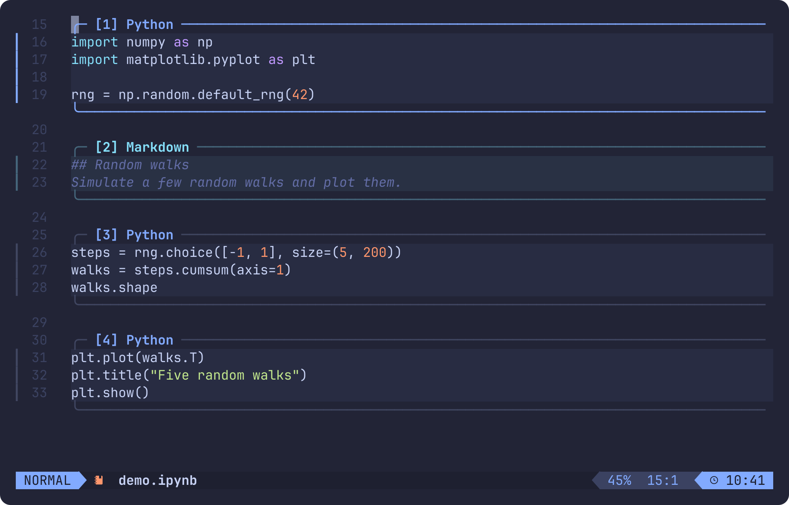

# notebook-cells.nvim

A Neovim plugin for editing `.ipynb` files. It draws each cell as a box, lets you move between cells with `j` and `k` like in Jupyter, and starts the kernel from the notebook's own virtualenv.

When a cell is selected (command mode), `j` and `k` move between cells. The selected cell has a blue border:



Press `Enter` or `i` to edit the cell. The border turns green, and now `j` and `k` move between lines like they normally do. `Esc` in normal mode takes you back to command mode:


It builds on two other plugins and does not replace them:

| Plugin | What it does |
|---|---|
| [jupytext.nvim](https://github.com/GCBallesteros/jupytext.nvim) | Opens an `.ipynb` as a script with `# %%` cell markers and converts it back when you save |
| [molten-nvim](https://github.com/benlubas/molten-nvim) | Runs code on a Jupyter kernel and shows the output |
| notebook-cells.nvim | Draws the cells, adds the command/edit modes and keys, picks the kernel, and keeps `git diff` small |

## What it does

- Draws each cell with a header (`╭─ [1] Python ───`), a bar on the left, a footer and a slightly different background. Markdown cells get another tint and the leading `# ` is hidden. The colors come from your colorscheme.
- Hides the `# ---` YAML block that jupytext puts at the top of the file. This needs Neovim 0.11. The block is still saved.
- Highlights the cell under the cursor.
- Has two modes. In command mode, `j`/`k` move between cells, `a`/`b` add a cell above or below, `dd` deletes the cell, `m` switches it between code and markdown, and `Enter` or `i` starts editing. In edit mode, Neovim behaves as usual. The `# %%` line can't be edited by accident.
- Runs a cell with `<leader>mc`. `<leader>mn` (or `Shift+Enter`) runs it and moves to the next cell.
- Finds the nearest `.venv` above the notebook, registers it as a Jupyter kernel and starts it. If there is no venv, it opens molten's kernel picker.
- Restores unchanged cells after saving. jupytext rewrites the whole file on save (trailing newlines, metadata and so on), which makes noisy diffs. After each save this plugin puts every cell you didn't touch back exactly as it was, so `git diff` only shows the cells you changed. Outputs are kept.

## Requirements

- Neovim 0.10 or newer
- [jupytext.nvim](https://github.com/GCBallesteros/jupytext.nvim) and the `jupytext` command (`uv tool install jupytext` or `pipx install jupytext`)
- [molten-nvim](https://github.com/benlubas/molten-nvim), which needs `pynvim` and `jupyter_client` in Neovim's Python host
- `python3` on your `PATH` for the save helper (it only uses the standard library)
- Optionally [uv](https://github.com/astral-sh/uv), used to install `ipykernel` into project venvs. Without it the plugin uses `pip`.

Run `:checkhealth notebook_cells` to check your setup.

## Install

With lazy.nvim:

```lua
{
  "mfshobur/notebook-cells.nvim",
  lazy = false, -- it has to be loaded before the first .ipynb is opened
  dependencies = {
    {
      "GCBallesteros/jupytext.nvim",
      lazy = false,
      opts = { style = "percent", output_extension = "auto", force_ft = "python" },
    },
    {
      "benlubas/molten-nvim",
      version = "^1.0.0",
      build = ":UpdateRemotePlugins",
      init = function()
        vim.g.molten_auto_open_output = true
        vim.g.molten_virt_text_output = true
        -- For inline plots, use image.nvim and a terminal that supports the kitty graphics protocol:
        -- vim.g.molten_image_provider = "image.nvim"
      end,
    },
  },
  opts = {},
}
```

jupytext.nvim must use `style = "percent"`. That is the only format this plugin reads.

## Configuration

These are the defaults. The same table is in [`lua/notebook_cells/config.lua`](lua/notebook_cells/config.lua).

```lua
require("notebook_cells").setup({
  patterns = { "*.ipynb" },
  labels = { code = "Python", markdown = "Markdown" },
  border = { top = "╭─", rule = "─", bottom = "╰", bar = "▎" },
  hide_header = true,    -- hide jupytext's YAML block (Neovim 0.11+)
  modal = true,          -- false: no command mode, behave like a normal buffer
  highlights = {},       -- for example { Active = { fg = "#ff9e64" } }

  -- Each key can be a string, a list of strings, or false to turn it off.
  -- keymaps = false turns all of them off.
  keymaps = {
    -- command mode
    next_cell = "j", prev_cell = "k",
    edit = { "<CR>", "i" },
    add_above = "a", add_below = "b",
    delete_cell = "dd", toggle_markdown = "m",
    -- switching modes
    exit_edit = "<Esc>", click_to_edit = "<LeftMouse>",
    -- both modes
    jump_next = "]c", jump_prev = "[c",
    run_cell = "<leader>mc",
    run_and_next = { "<leader>mn", "<S-CR>" },
    new_code_below = "<leader>ma", new_markdown_below = "<leader>mA",
    start_kernel = "<leader>mi", pick_kernel = "<leader>mI",
  },

  kernel = {
    enabled = true,
    venv_dirs = { ".venv", "venv" },
    use_virtual_env = true,       -- use $VIRTUAL_ENV if no venv directory is found
    install_ipykernel = "ask",    -- "ask", true or false
    fallback_picker = true,       -- open molten's picker if no venv is found
    startup_timeout = 10000,      -- milliseconds
  },

  minimal_diff = {
    enabled = true,
    python = nil,                 -- defaults to python3, then python
  },
})
```

### Highlight groups

`NotebookCellsCodeBody`, `NotebookCellsMarkdownBody`, `NotebookCellsIdle`, `NotebookCellsIdleMarkdown`, `NotebookCellsActive`, `NotebookCellsActiveMarkdown`, `NotebookCellsEdit`, `NotebookCellsCodeLabel`, `NotebookCellsMarkdownLabel`.

They are rebuilt from your colorscheme every time it changes. To change one, use the `highlights` option.

### Lua functions and commands

```lua
local nb = require("notebook_cells")
nb.run_cell(false)   -- run the current cell
nb.run_cell(true)    -- run it, then go to the next cell
nb.goto_cell(1)      -- next cell (-1 for the previous one)
nb.new_cell(false)   -- new code cell below (true for markdown)
nb.start_kernel()    -- start the project's kernel
```

Commands: `:NotebookCellsRun`, `:NotebookCellsRunNext`, `:NotebookCellsKernel`

## How the kernel is chosen

1. It looks for `.venv` (or `venv`, see `kernel.venv_dirs`) in the notebook's folder and its parents. If none is found it uses `$VIRTUAL_ENV`.
2. It asks that venv's Python where Jupyter keeps its kernels. If `ipykernel` isn't installed there, it asks whether to install it.
3. It registers a kernel called `venv-<project>-<hash>` with `ipykernel install --user`. If you move the venv, the kernel is registered again.
4. It runs `:MoltenInit` with that kernel, waits until it is ready, then runs the cell.

If a kernel is already running for the buffer, that one is used. Pressing the run key again while the kernel is still starting does nothing.

## Limitations

- Only jupytext's percent format is supported (`# %%` and `# %% [markdown]`).
- The cells are drawn with extmarks, so there are no buttons or toolbars on them.
- Kernel detection looks for `venv`-style folders, including ones made by uv. It does not know about poetry or conda environments.
- The save helper compares against a copy of the file taken when you opened it. If another program changes the notebook while it is open in Neovim, close and reopen it before saving, or those changes can be overwritten.
- While a notebook is on screen, the plugin sets `conceallevel`, `signcolumn` and a few other window options. It puts them back when the notebook leaves the window.

## Tests

```sh
nvim --headless -u NONE -l tests/smoke.lua   # cell drawing and editing actions
python3 tests/test_minimal_diff.py           # the save helper
```

## License

MIT
